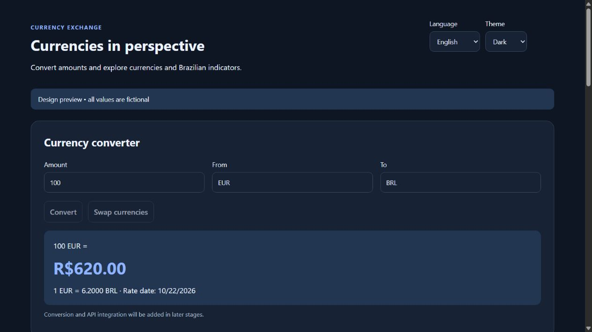
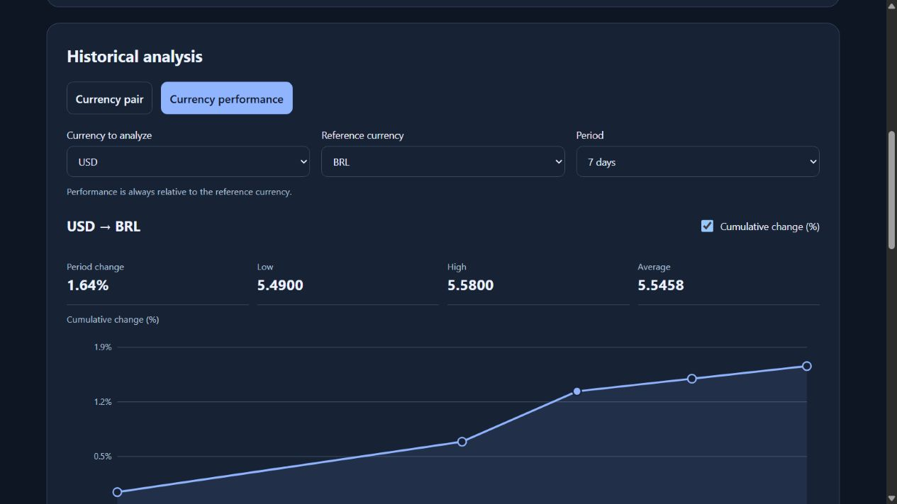

# Revisão da etapa 02 — 24/10/2026

Solicitação do aluno: tema escuro, opção de inglês, gráfico detalhado, análise individual de moedas, Ibovespa e Selic. São extensões do projeto; os requisitos obrigatórios do Notion permanecem prioritários para a entrega de 27/10/2026.

## Estado da entrega

- Prévia de design navegável em `docs/prototypes/`, com tema, idioma e exploração do gráfico.
- Dicionários português/inglês em `src/i18n/`, preparados para uso futuro no React.
- O Figma NÃO foi atualizado: a integração retornou limite de chamadas do plano Starter. Manter o arquivo anterior como referência da primeira versão. A sincronização desta revisão está pendente.
- Nenhuma API de mercado está conectada. Conversão, filtros e CSV estão desabilitados nesta prévia. Valores de moedas, Ibovespa e Selic são fictícios.

## Executar a prévia

Com Node.js instalado, na raiz do projeto:

```sh
node scripts/preview.cjs
```

Abrir `http://127.0.0.1:4173`. O servidor escuta somente na máquina local e serve apenas a pasta de protótipos e os dicionários. Encerrar com Ctrl+C. Esta prévia HTML é um artefato de design; não substitui a etapa React/Vite nem antecipa a entrega da SPA.

## Tema e idioma

- Tema claro, escuro ou sistema. A escolha explícita prevalece sobre a preferência do sistema.
- Português e inglês trocam rótulos, mensagens, datas, separadores numéricos e unidades textuais.
- Persistência opcional em localStorage, sem quebrar a interface se o armazenamento estiver bloqueado.
- Tema usa tokens semânticos para superfície, texto, borda, foco, ação e série do gráfico.
- CSS Modules continuam obrigatórios na SPA. O CSS da prévia serve somente ao desenho navegável.

## Gráfico detalhado

Eixos com datas e unidades, linha com pontos, mínima, máxima, média aritmética das observações e variação entre primeira e última cotação disponíveis. Inspeção por mouse/toque e por controle de intervalo acessível ao teclado. Escolha entre cotação nominal e variação acumulada percentual.

Fórmula: `((cotação final / cotação inicial) - 1) × 100`. Não calcular sem duas observações válidas ou com denominador zero. Valores devem ser ordenados por data antes do cálculo. Janela solicitada e datas efetivamente disponíveis podem diferir; informar ambas na aplicação final.

A média é das observações disponíveis, sem ponderação por número de dias. Não fabricar cotações ausentes. Em períodos longos, uma redução visual de pontos não deve alterar os dados exportados ou o cálculo das estatísticas.

Na prévia há somente cinco observações sintéticas por período. O seletor reposiciona datas de exemplo, sem buscar histórico real. A inspeção exibe data completa, cotação e variação desde o primeiro ponto; os eixos usam menos rótulos em telas estreitas.

## Valorização individual

O botão **Valorização da moeda / Currency performance** seleciona a visão percentual e mostra moeda analisada e referência. Referência inicial: BRL. O usuário pode escolher outra; para analisar BRL, usar por exemplo USD. Pares iguais não representam análise útil e são impedidos.

Exemplo: USD/BRL de 5 para 5,5 significa valorização de 10% do USD em relação ao BRL. Não é valorização absoluta e não equivale automaticamente a rendimento líquido de uma aplicação. A visão nominal continua disponível.

O gráfico e sua tabela compartilham o par de análise. O conversor pode permanecer independente ao explorar outra moeda; identificar claramente o par em cada região.

## Selic

Definição adotada: **meta Selic**, definida pelo Copom e publicada em **% ao ano**, série SGS 432 do Banco Central. Não confundir com Selic efetiva nem apresentar a taxa anual como retorno acumulado.

Fonte primária: [metadados e recurso JSON da série 432](https://dadosabertos.bcb.gov.br/dataset/432-taxa-de-juros---meta-selic-definida-pelo-copom). Consultado em 24/10/2026. O catálogo informa limite de dez anos por consulta de intervalo para séries diárias.

Escopo inicial: card com último valor disponível, unidade, data e fonte; loading/erro próprios. Histórico da Selic e simulação de rendimento não estão incluídos nesta extensão inicial.

## Ibovespa

Mostrar valor em pontos, variação percentual diária quando disponível, data/hora de referência e fornecedor. Não tratar o índice como moeda nem substituir seus dados pelos de um ETF como BOVA11.

Fonte conceitual: [Ibovespa B3](https://b3.com.br/pt_br/market-data-e-indices/indices/indices-amplos/ibovespa-b3.htm). A B3 descreve o índice como uma carteira teórica de ativos.

**Provedor da API ainda pendente de validação.** A [brapi](https://brapi.dev/docs) é candidata para investigação, não uma integração confirmada do Ibovespa. Sua documentação exige chave para a maioria dos dados e prevê restrições por plano. Confirmar especificamente cobertura do índice, histórico, atraso, limites, CORS e licença antes de adotar.

Não inserir chaves privadas no front-end ou em variáveis VITE_: elas ficam visíveis no navegador. Se o fornecedor exigir segredo, avaliar um proxy seguro como mudança explícita de arquitetura. Nenhuma conta, plano pago ou back-end foi criado.

Se o dado estiver indisponível, manter o card com estado indisponível e não prejudicar o conversor. Não prometer cotação em tempo real.

## Sequência de implementação

1. Etapa 03: refletir o desenho revisado na interface JSX estática.
2. Etapas 05/06: dicionários via props, preferências de idioma/tema e seleção da análise.
3. Etapa 07: validar Frankfurter, série 432 e candidato a fornecedor do Ibovespa no Postman.
4. Etapas 08–12: cálculo das estatísticas, percentual, serviços, hooks e gráfico detalhado.
5. Indicadores extras em commits separados, com falhas isoladas e documentação das fontes.

## Verificações de aceite futuras da SPA

- Tema escuro não perde legibilidade em campos, tabela, gráfico, foco e mensagens.
- Trocar idioma não altera moeda, filtros, período ou resultados numéricos.
- Todos os textos próprios da aplicação têm tradução; nomes de moedas possuem fallback.
- Tema e idioma persistem e têm defaults seguros.
- Taxas 5 e 5,5 produzem variação de 10%; pontos do gráfico coincidem com a tabela.
- Selic exibe % ao ano; Ibovespa exibe pontos; ambos incluem fonte e data.
- Falha de um indicador não bloqueia câmbio, histórico, filtros ou CSV.

## Evidências da prévia

Conferidos no navegador desktop: tema claro/escuro, português/inglês, persistência das duas preferências após recarregar, análise USD/BRL, percentual, seleção de período e inspeção pelo teclado. Sintaxe JavaScript e as 98 chaves de tradução passaram nas verificações locais. Mobile, contraste automatizado e integrações reais permanecem pendentes.




