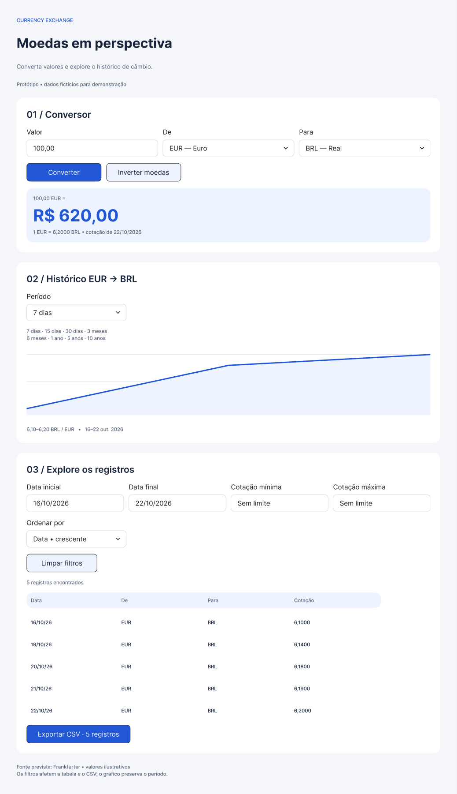

# Protótipos — Etapa 02

Criados em 23/10/2026. [Abrir arquivo editável no Figma](https://www.figma.com/design/rgsHk6WPseuvUMbXtuAd2z).

**Revisão de 24/10/2026:** tema escuro, inglês, gráfico detalhado e indicadores estão na prévia local descrita em [ENHANCEMENTS.md](ENHANCEMENTS.md). O Figma permanece na versão de 23/10 porque a integração atingiu o limite de chamadas do plano Starter. Não considerar as imagens abaixo evidência dos novos recursos. Sincronização pendente.

## Telas

| Entrega | Figma | Evidência local |
| --- | --- | --- |
| Wireframe desktop, 1100 px | [Abrir](https://www.figma.com/design/rgsHk6WPseuvUMbXtuAd2z?node-id=2-313) | [PNG](images/wireframe-desktop.png) |
| Wireframe mobile, 390 px | [Abrir](https://www.figma.com/design/rgsHk6WPseuvUMbXtuAd2z?node-id=2-476) | [PNG](images/wireframe-mobile.png) |
| Média fidelidade desktop, 1100 px | [Abrir](https://www.figma.com/design/rgsHk6WPseuvUMbXtuAd2z?node-id=2-636) | [PNG](images/prototype-desktop.png) |
| Média fidelidade mobile, 390 px | [Abrir](https://www.figma.com/design/rgsHk6WPseuvUMbXtuAd2z?node-id=2-798) | [PNG](images/prototype-mobile.png) |
| Estados desktop | [Abrir](https://www.figma.com/design/rgsHk6WPseuvUMbXtuAd2z?node-id=2-960) | [PNG](images/states-desktop.png) |
| Estados mobile | [Abrir](https://www.figma.com/design/rgsHk6WPseuvUMbXtuAd2z?node-id=3-278) | [PNG](images/states-mobile.png) |

## O que estamos aprendendo

**Wireframe** define organização, prioridade e posição dos controles. A versão de baixa fidelidade usa tons de cinza para concentrar a discussão na estrutura.

**Média fidelidade** acrescenta tipografia, cores e hierarquia visual. O resultado da conversão recebe destaque; ações secundárias têm menor peso visual.

**Responsividade** reorganiza o conteúdo conforme o espaço disponível. No desktop os campos compartilham uma linha; no celular ficam empilhados. A proposta mantém as quatro colunas da tabela com siglas de moeda e datas compactas. Na implementação, conferir larguras menores e oferecer rolagem horizontal da tabela caso necessária.

**Estados de interface** explicam a situação da operação: carregamento, erro, ausência de registros e entrada inválida. Eles não são sinônimos. A API pode responder corretamente e ainda assim os filtros produzirem zero registros.

## Decisões visuais

- Ordem: conversor → histórico → tabela, filtros e CSV.
- Fonte Inter; fundo claro; azul #2258D5 para ação principal e resultado; texto #17243B.
- Controles reutilizados da biblioteca Simple Design System; textos e vetores permanecem editáveis.
- Campos têm rótulos visíveis. Ações usam verbos: converter, inverter, limpar e exportar.
- Oito períodos explicitados no desenho. O seletor mostra a seleção atual; a lista textual registra as opções previstas.
- Os dados são fictícios e estão identificados como tal. Não são cotações verificadas.
- Gráfico ilustrativo baseado nos cinco valores da tabela; não é um gráfico interativo implementado.
- Coleção local de cores semânticas e estilos de texto; serão referências para CSS Modules na etapa de implementação.

## Comportamentos planejados

| Ação/situação | Resposta esperada |
| --- | --- |
| Converter | Validar valor e apresentar cálculo com taxa/data do par atual. |
| Inverter moedas | Trocar o par, preservar o valor e atualizar as consultas. |
| Alterar período | Atualizar histórico e limpar filtros da tabela. |
| Aplicar filtros | Atualizar tabela e contador; gráfico mantém o período completo. |
| Limpar filtros | Restaurar os registros do período selecionado. |
| Exportar CSV | Exportar somente as linhas filtradas e ordenadas. |
| Carregando | Comunicar espera e desabilitar conversão sem taxa disponível. |
| Erro | Exibir mensagem e oferecer nova tentativa. |
| Sem registros | Orientar alteração/limpeza de filtros e desabilitar CSV. |
| Entrada inválida | Explicar o problema perto do campo e permitir correção. |

## Validação e limites

As seis composições foram inspecionadas visualmente. Foram corrigidos espaçamento excessivo das linhas e contraste das ações secundárias. A leitura estrutural confirmou fonte Inter, instâncias de controles, textos e vetores editáveis, sem imagem achatada da interface.

São protótipos visuais estáticos: não há fluxo clicável configurado, cálculos, consultas, download CSV ou testes reais de teclado e responsividade. Os estados são apresentados em painéis de referência, para aplicação junto à região afetada durante a implementação. A validação do aluno sobre a proposta visual permanece pendente.

