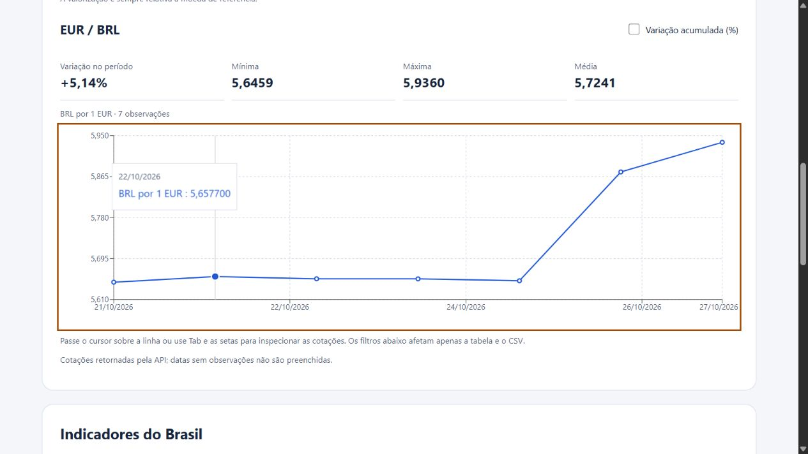
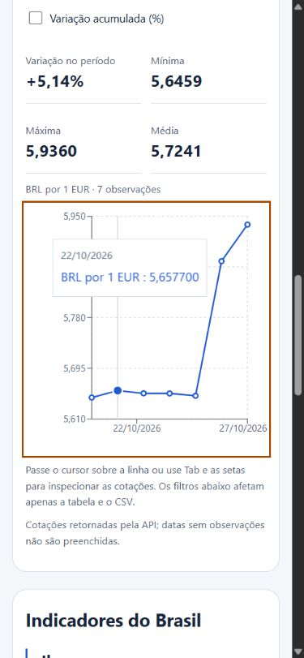

# Revisão final — 27/10/2026

## Verificações automatizadas
- 25 testes Node: cálculos, datas, filtros, ordenação, CSV, preferências, respostas inválidas, HTTP e cancelamento.
- 123 chaves de tradução em português/inglês compatíveis.
- 21 verificações da collection sobre respostas previamente salvas.
- Build de produção passou sem o aviso anterior de pacote acima de 500 kB.
- Pacote inicial: 252.02 kB (79.11 kB gzip); gráfico: 352.11 kB (102.32 kB gzip).

## Verificação no navegador local
Testada a compilação no caminho /currency-exchange-app/, pela porta 4175 porque havia uma prévia antiga em 4174.
- Conversão EUR/BRL com zero resultou em R$ 0,00.
- Valor negativo mostrou mensagem e não produziu resultado.
- Inversão BRL/EUR preservou valor e converteu 100 BRL em € 16,85 na consulta executada.
- Taxa e data efetiva exibidas. Valores são evidência desta consulta, não expectativas fixas.
- Histórico de dez anos exibiu 3653 linhas; retorno a sete dias funcionou.
- Gráfico respondeu às setas e mostrou data/cotação.
- Filtro sem resultados desabilitou exportação. CSV e ordem já validados no bloco 2 por download real.
- Idioma inglês e tema escuro persistiram após recarregar.
- Layout inspecionado em viewport padrão e 390 px; sem transbordamento da página.
- Em 320 px foi encontrado limite mínimo do body causando transbordamento com a barra de rolagem. Corrigido; largura do documento e área útil passaram a coincidir em 305 px.
- Nenhum erro de console associado ao bundle final nas consultas verificadas.

## Evidências

## Limites da verificação
Não é certificação completa de acessibilidade nem teste de todos os navegadores/dispositivos. Teclado foi verificado no gráfico e os formulários possuem rótulos. Erros de rede/HTTP foram cobertos por testes de serviço; não houve simulação de indisponibilidade externa na interface nesta rodada. Todos os oito períodos têm cálculo implementado; 7 dias e 10 anos foram exercitados nesta rodada, e 15 dias no bloco anterior.

Consulta pública ao GitHub confirmou private:false e has_pages:false. Não houve execução remota do workflow: depende do commit/push do aluno. Não houve execução no aplicativo Postman nem alteração do arquivo Figma nesta revisão.
